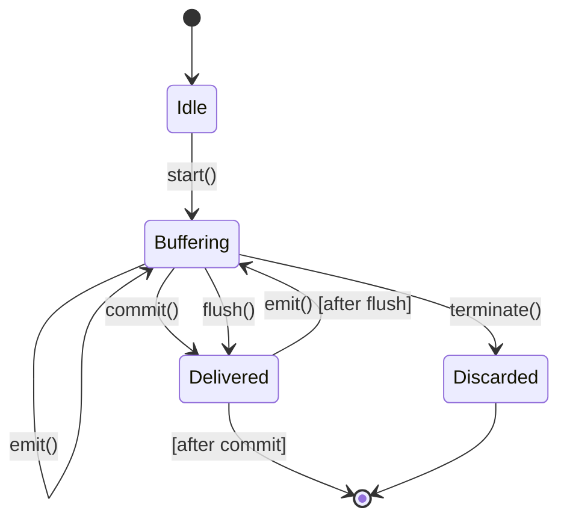
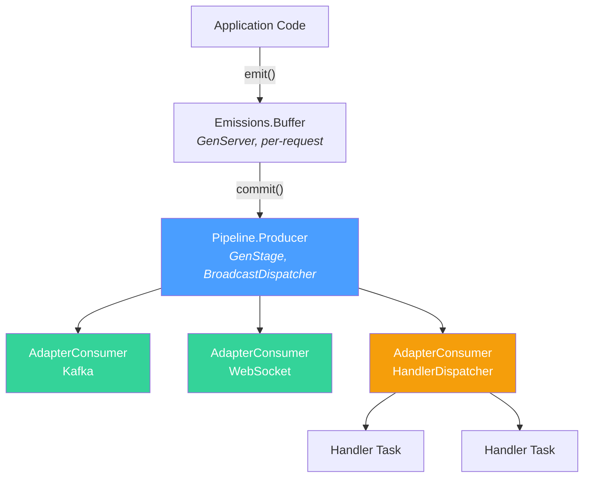

# Emissions

Event emission library for Elixir with pluggable adapters, per-request buffering, and a GenStage-powered delivery pipeline.

Emissions provides a structured way to emit events to multiple destinations (Kafka, WebSockets, webhooks, etc.) with backpressure, internal event handling, and transactional buffer semantics.

## Features

- **Per-request event buffering** — Collect events during a request/transaction and commit them atomically
- **Pluggable adapters** — Deliver events to any destination by implementing a simple behaviour
- **GenStage pipeline** — Fan-out to multiple adapters with independent backpressure per consumer
- **Internal event handlers** — Subscribe to events and handle them in supervised tasks with cascading support
- **Topic routing** — Optional compile-time event-to-topic mapping
- **Telemetry** — Comprehensive instrumentation for monitoring and observability
- **Test helpers** — Capture and assert on emitted events in tests

## Installation

Add `emissions` to your list of dependencies in `mix.exs`:

```elixir
def deps do
  [
    {:emissions, "~> 0.1.0"}
  ]
end
```

## Quick Start

### 1. Configure Adapters

```elixir
# config/config.exs
config :emissions,
  adapters: [
    {MyApp.KafkaAdapter, topic: "my-events"},
    {MyApp.WebSocketAdapter, endpoint: MyApp.Endpoint}
  ],
  handlers: [
    MyApp.SearchIndexHandler,
    MyApp.NotificationHandler
  ]
```

### 2. Emit Events

```elixir
def create_order(params) do
  Emissions.start()

  case Orders.insert(params) do
    {:ok, order} ->
      Emissions.emit(:order_created, order, %{source: "api"})
      Emissions.commit()
      {:ok, order}

    {:error, changeset} ->
      Emissions.terminate()
      {:error, changeset}
  end
end
```

### 3. Implement an Adapter

```elixir
defmodule MyApp.KafkaAdapter do
  @behaviour Emissions.Adapter

  @impl true
  def init(opts) do
    topic = Keyword.fetch!(opts, :topic)
    {:ok, %{topic: topic}}
  end

  @impl true
  def handle_events(events, state) do
    for event <- events do
      message = %{name: event.name, payload: event.payload, metadata: event.metadata}
      MyApp.Kafka.produce(state.topic, Jason.encode!(message))
    end

    {:ok, state}
  end
end
```

### 4. Implement a Handler

```elixir
defmodule MyApp.SearchIndexHandler do
  use Emissions.Handler

  @impl true
  def events, do: [:order_created, :order_updated, :order_deleted]

  @impl true
  def handle_event(:order_created, payload, _metadata) do
    MyApp.Search.index(:orders, payload)
    :ok
  end

  def handle_event(:order_updated, payload, _metadata) do
    MyApp.Search.update(:orders, payload.id, payload)
    :ok
  end

  def handle_event(:order_deleted, payload, _metadata) do
    MyApp.Search.delete(:orders, payload.id)
    :ok
  end
end
```

## Topic Router

Optionally map events to logical topics at compile time:

```elixir
defmodule MyApp.Topics do
  use Emissions.TopicRouter,
    mappings: %{
      orders: [:order_created, :order_updated, :order_shipped],
      inventory: [:item_received, :item_adjusted, :item_moved],
      users: [:user_created, :user_updated]
    }
end

MyApp.Topics.topic_for_event(:order_created)
#=> :orders

MyApp.Topics.topics()
#=> [:orders, :inventory, :users]
```

Adapters can use the topic router during event processing to determine routing:

```elixir
defmodule MyApp.KafkaAdapter do
  @behaviour Emissions.Adapter

  @impl true
  def init(opts), do: {:ok, %{prefix: Keyword.get(opts, :prefix, "events")}}

  @impl true
  def handle_events(events, state) do
    for event <- events do
      topic = MyApp.Topics.topic_for_event(event.name)
      kafka_topic = "#{state.prefix}.#{topic}"
      MyApp.Kafka.produce(kafka_topic, Jason.encode!(event.payload))
    end

    {:ok, state}
  end
end
```

## Filtering Events per Adapter

Implement the optional `interested?/2` callback to filter events:

```elixir
defmodule MyApp.OrderAdapter do
  @behaviour Emissions.Adapter

  @impl true
  def init(_opts), do: {:ok, %{}}

  @impl true
  def interested?(event, _state) do
    event.name in [:order_created, :order_updated, :order_shipped]
  end

  @impl true
  def handle_events(events, state) do
    # Only receives order events
    for event <- events, do: process_order_event(event)
    {:ok, state}
  end

  defp process_order_event(_event), do: :ok
end
```

## Buffer Lifecycle



- `start/0` — Creates a per-request buffer linked to the calling process
- `emit/3` — Asynchronously appends an event to the buffer
- `commit/0` — Hands events to the GenStage pipeline and terminates the buffer
- `flush/0` — Like commit, but keeps the buffer open for more events
- `terminate/0` — Discards buffered events and cleans up

## Architecture



## Configuration

```elixir
config :emissions,
  # List of {module, opts} tuples — one GenStage consumer per adapter
  adapters: [
    {MyApp.KafkaAdapter, topic: "events"},
    {MyApp.WebSocketAdapter, endpoint: MyApp.Endpoint}
  ],

  # List of handler modules implementing Emissions.Handler
  handlers: [
    MyApp.SearchIndexHandler,
    MyApp.NotificationHandler
  ],

  # GenStage pipeline tuning (optional)
  pipeline: [
    max_demand: 50   # per-consumer max demand from the producer
  ]
```

## Testing

### Setup

```elixir
# config/test.exs
config :emissions,
  adapters: [{Emissions.Testing.TestAdapter, []}],
  handlers: []
```

```elixir
# test/test_helper.exs
Emissions.Testing.setup()
ExUnit.start()
```

### Usage

```elixir
defmodule MyApp.OrdersTest do
  use ExUnit.Case
  import Emissions.Testing

  setup do
    Emissions.Testing.reset()
    :ok
  end

  test "creating an order emits order_created" do
    MyApp.Orders.create(%{item: "widget", qty: 5})

    assert_emitted(:order_created)
    assert_emitted(:order_created, fn event ->
      assert event.payload.item == "widget"
    end)
  end

  test "failed order does not emit events" do
    MyApp.Orders.create(%{invalid: true})
    refute_emitted(:order_created)
  end
end
```

## Telemetry Events

| Event | Measurements | Metadata |
|---|---|---|
| `[:emissions, :buffer, :started]` | `%{count: 1}` | `%{}` |
| `[:emissions, :buffer, :committed]` | `%{count: n}` | `%{event_count: n}` |
| `[:emissions, :buffer, :terminated]` | `%{count: 1}` | `%{event_count: n}` |
| `[:emissions, :event, :dropped]` | `%{count: 1}` | `%{event_name: atom(), reason: atom()}` |
| `[:emissions, :adapter, :success]` | `%{duration: integer()}` | `%{adapter: module(), event_count: n}` |
| `[:emissions, :adapter, :error]` | `%{duration: integer()}` | `%{adapter: module(), reason: term(), event_count: n}` |
| `[:emissions, :handler, :success]` | `%{duration: integer()}` | `%{handler: module(), event: atom()}` |
| `[:emissions, :handler, :error]` | `%{duration: integer()}` | `%{handler: module(), event: atom(), reason: term()}` |
| `[:emissions, :handler, :ignored]` | `%{count: 1}` | `%{handler: module(), event: atom()}` |

## Contributing

1. Fork it
2. Create your feature branch (`git checkout -b my-new-feature`)
3. Write tests for your changes
4. Ensure all tests pass (`mix test`)
5. Run the formatter (`mix format`)
6. Commit your changes using [conventional commits](https://www.conventionalcommits.org/)
7. Push to the branch (`git push origin my-new-feature`)
8. Create a Pull Request

### Development

```bash
# Install dependencies
mix deps.get

# Run tests
mix test

# Run formatter
mix format

# Generate docs
mix docs
```

## License

MIT License. See [LICENSE](LICENSE) for details.
