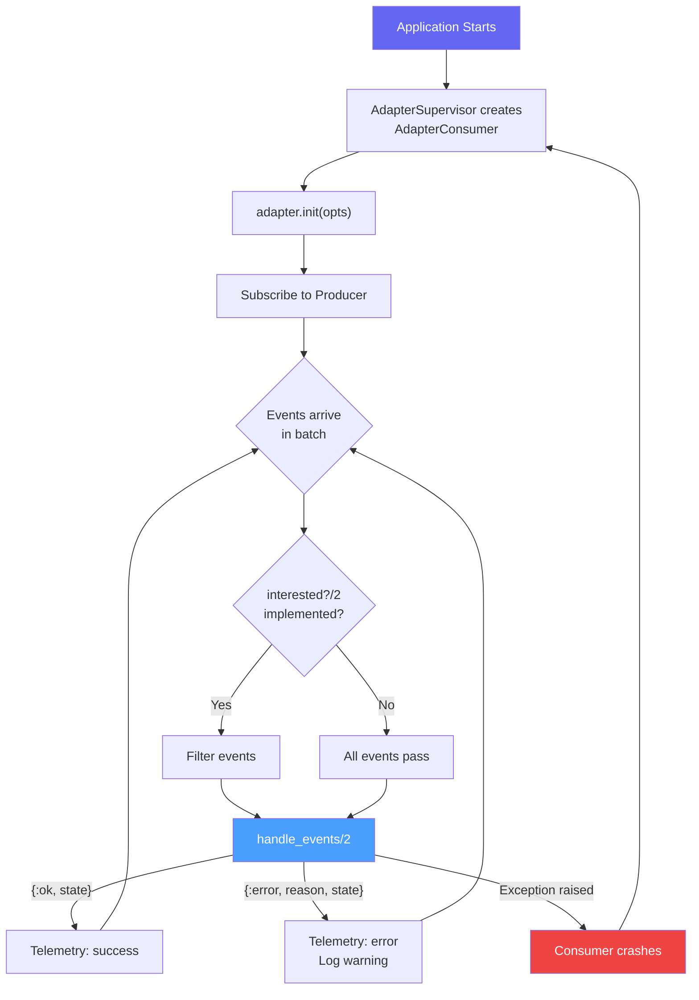

# Adapters

Adapters are the delivery mechanism for events. Each adapter implements the `Emissions.Adapter` behaviour and receives batches of events through the GenStage pipeline.

## Implementing an Adapter

An adapter needs two callbacks: `init/1` and `handle_events/2`.

```elixir
defmodule MyApp.WebhookAdapter do
  @behaviour Emissions.Adapter

  @impl true
  def init(opts) do
    url = Keyword.fetch!(opts, :url)
    {:ok, %{url: url}}
  end

  @impl true
  def handle_events(events, state) do
    payload = Enum.map(events, &Map.from_struct/1)

    case HTTPClient.post(state.url, Jason.encode!(payload)) do
      {:ok, _response} -> {:ok, state}
      {:error, reason} -> {:error, reason, state}
    end
  end
end
```

### `init/1`

Called once when the adapter consumer starts. Receives the options from the configuration tuple. Return `{:ok, state}` where `state` is passed to all subsequent callbacks.

### `handle_events/2`

Receives a batch of `Emissions.Event` structs and the current state. Return `{:ok, new_state}` on success or `{:error, reason, new_state}` on failure. Failures are logged and reported via telemetry but do not crash the adapter consumer.

## Filtering Events

Implement the optional `interested?/2` callback to receive only specific events:

```elixir
defmodule MyApp.OrderWebhookAdapter do
  @behaviour Emissions.Adapter

  @impl true
  def init(opts), do: {:ok, %{url: Keyword.fetch!(opts, :url)}}

  @impl true
  def interested?(event, _state) do
    event.name in [:order_created, :order_shipped, :order_canceled]
  end

  @impl true
  def handle_events(events, state) do
    # Only receives order events
    for event <- events do
      HTTPClient.post(state.url, Jason.encode!(event.payload))
    end

    {:ok, state}
  end
end
```

When `interested?/2` is not implemented, the adapter receives all events.

## Serialization

Adapters can use the `Emissions.Serializer` behaviour to transform events before delivery. Accept a `:serializer` option in `init/1` and default to `Emissions.Serializer.Default` when none is configured:

```elixir
defmodule MyApp.WebhookAdapter do
  @behaviour Emissions.Adapter

  @impl true
  def init(opts) do
    url = Keyword.fetch!(opts, :url)
    serializer = Keyword.get(opts, :serializer, Emissions.Serializer.Default)
    {:ok, %{url: url, serializer: serializer}}
  end

  @impl true
  def handle_events(events, state) do
    payload = Enum.map(events, &state.serializer.serialize/1)

    case HTTPClient.post(state.url, Jason.encode!(payload)) do
      {:ok, _response} -> {:ok, state}
      {:error, reason} -> {:error, reason, state}
    end
  end
end
```

The default serializer produces JSON-friendly maps with no configuration required. Custom serializers can return maps, binaries (Avro, Protobuf), or any other format. See the [Serialization guide](serialization.md) for details.

## Configuration

Register adapters as `{module, opts}` tuples in your application config:

```elixir
config :emissions,
  adapters: [
    {MyApp.KafkaAdapter, topic: "domain-events", producer: MyApp.KafkaProducer},
    {MyApp.WebhookAdapter, url: "https://hooks.example.com/events"},
    {MyApp.WebSocketAdapter, endpoint: MyApp.Endpoint}
  ]
```

Each adapter gets its own GenStage consumer with independent backpressure. A slow Kafka adapter will not block the WebSocket adapter.

## Adapter Lifecycle



## Error Handling

When `handle_events/2` returns `{:error, reason, state}`:

- The error is logged via `Logger.error/2`
- A `[:emissions, :adapter, :error]` telemetry event is emitted
- The consumer continues processing — it does not crash or restart
- The updated state is preserved

If the adapter raises an exception, the GenStage consumer crashes and the supervisor restarts it. The adapter's `init/1` is called again with the original options, so any accumulated state is lost.
