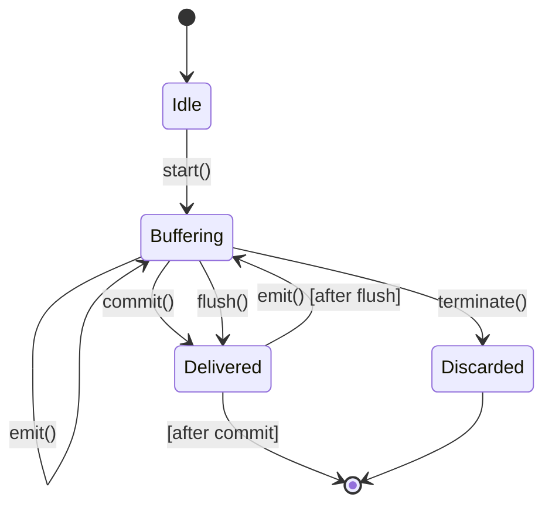
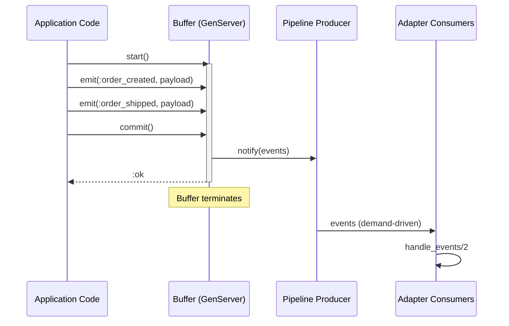

# Buffering

Emissions uses per-request event buffers to collect events during a unit of work and deliver them atomically on commit. This pattern provides transactional semantics — either all events from a request are delivered, or none are.

## Lifecycle



### Starting a Buffer

```elixir
Emissions.start()
```

Creates a new `Emissions.Buffer` GenServer under the `Emissions.BufferPool` (a `DynamicSupervisor`). The buffer PID is stored in the calling process's dictionary and linked to the caller for automatic cleanup.

Calling `start/0` when a buffer is already active returns `{:error, :already_started}`.

### Emitting Events

```elixir
Emissions.emit(:order_created, %{id: 1, total: 99.99}, %{source: "api"})
```

Appends an event to the buffer asynchronously via `GenServer.cast`. This is non-blocking — the caller does not wait for the buffer to process the event.

If no buffer is active, `emit/3` returns `{:error, :not_started}` and fires a `[:emissions, :event, :dropped]` telemetry event.

### Committing

```elixir
Emissions.commit()
```

Sends all buffered events to the GenStage pipeline and terminates the buffer. This is a synchronous `GenServer.call` that ensures events are handed off to the producer before returning. However, delivery to adapters happens asynchronously — `commit/0` returns immediately once events are queued in the pipeline.

After committing, the buffer is no longer active. Subsequent `emit/3` calls will return `{:error, :not_started}`.

### Flushing

```elixir
Emissions.flush()
```

Like `commit/0`, but keeps the buffer open. Useful when you want to deliver events collected so far but continue collecting more:

```elixir
Emissions.start()

# Phase 1: validation
Emissions.emit(:order_validated, order)
Emissions.flush()  # deliver validation events immediately

# Phase 2: fulfillment
Emissions.emit(:order_fulfilled, order)
Emissions.commit()  # deliver fulfillment events and close buffer
```

### Terminating

```elixir
Emissions.terminate()
```

Discards all buffered events and stops the buffer. Use this when an operation fails and events should not be delivered:

```elixir
Emissions.start()

case MyApp.Orders.create(params) do
  {:ok, order} ->
    Emissions.emit(:order_created, order)
    Emissions.commit()

  {:error, changeset} ->
    Emissions.terminate()  # discard any events
    {:error, changeset}
end
```

Calling `terminate/0` when no buffer is active is a safe no-op.

## Event Flow on Commit



## Process Linking

The buffer is linked to the calling process. If the caller exits (normally or abnormally), the buffer is automatically cleaned up. This prevents orphaned buffer processes from accumulating.

## Concurrency

Each process gets its own independent buffer. Multiple processes can emit events concurrently without interference. This aligns naturally with web request handling where each request runs in its own process.

Internal event handlers also get their own buffer per invocation, enabling cascading events without interfering with the original request's buffer.
