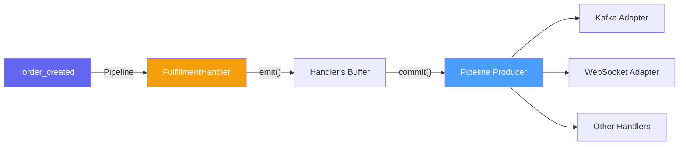
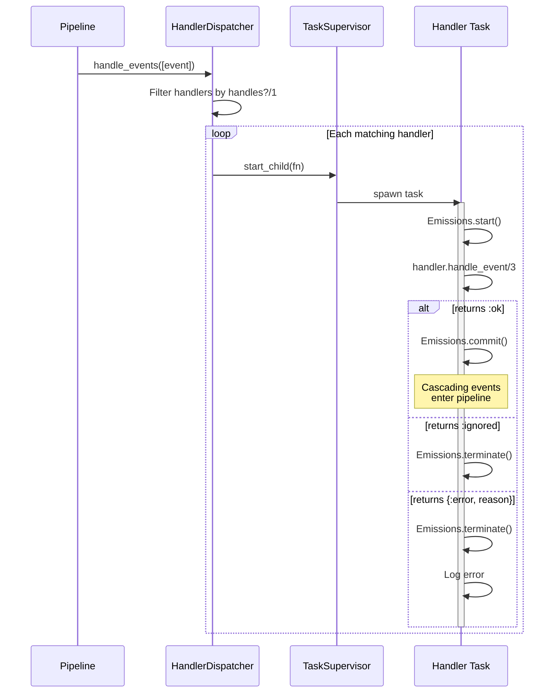

# Internal Event Handlers

Handlers subscribe to specific event names and process them in supervised tasks. They run alongside adapters in the GenStage pipeline, but each handler invocation is isolated in its own task with its own event buffer.

## Implementing a Handler

Use the `Emissions.Handler` macro and implement two callbacks:

```elixir
defmodule MyApp.SearchIndexHandler do
  use Emissions.Handler

  @impl true
  def events, do: [:product_created, :product_updated, :product_deleted]

  @impl true
  def handle_event(:product_created, payload, _metadata) do
    MyApp.Search.index(:products, payload)
    :ok
  end

  def handle_event(:product_updated, payload, _metadata) do
    MyApp.Search.update(:products, payload.id, payload)
    :ok
  end

  def handle_event(:product_deleted, payload, _metadata) do
    MyApp.Search.delete(:products, payload.id)
    :ok
  end
end
```

### `events/0`

Returns a list of event name atoms this handler subscribes to. Only events matching these names will be dispatched to `handle_event/3`.

### `handle_event/3`

Called with the event name, payload, and metadata. Must return one of:

- `:ok` — Success. Any events emitted during handling are committed.
- `:ignored` — The event was not relevant. No further action.
- `{:error, reason}` — Handling failed. The error is logged and reported via telemetry.

## Cascading Events

Each handler invocation gets its own event buffer. This means handlers can emit new events that will be delivered through the full pipeline:

```elixir
defmodule MyApp.FulfillmentHandler do
  use Emissions.Handler

  @impl true
  def events, do: [:order_created]

  @impl true
  def handle_event(:order_created, payload, _metadata) do
    case MyApp.Fulfillment.check_availability(payload) do
      :available ->
        Emissions.emit(:order_fulfillable, payload, %{source: "fulfillment_check"})
        :ok

      :unavailable ->
        Emissions.emit(:order_backordered, payload, %{reason: :out_of_stock})
        :ok
    end
  end
end
```

When `handle_event/3` returns `:ok`, the handler's buffer is committed and the cascading events flow through the pipeline to all adapters and other handlers.



## Configuration

Register handlers in your application config:

```elixir
config :emissions,
  handlers: [
    MyApp.SearchIndexHandler,
    MyApp.FulfillmentHandler,
    MyApp.NotificationHandler
  ]
```

## Execution Model



Handlers run inside a `Task.Supervisor` task, which provides:

- **Isolation** — A crash in one handler does not affect others
- **Concurrency** — Multiple handlers for the same event run concurrently
- **Supervision** — Failed tasks are cleaned up automatically

The dispatcher filters handlers by calling `handles?/1` (defined by the macro) before dispatching. Only handlers that subscribe to the event name are invoked.

## Return Values and Side Effects

| Return Value | Buffer | Telemetry Event |
|---|---|---|
| `:ok` | Committed (cascading events delivered) | `[:emissions, :handler, :success]` |
| `:ignored` | Terminated (no events delivered) | `[:emissions, :handler, :ignored]` |
| `{:error, reason}` | Terminated (no events delivered) | `[:emissions, :handler, :error]` |
| Exception raised | Terminated (no events delivered) | Logged via `Logger.error/2` |

In all cases, the handler's event buffer is cleaned up via `Emissions.terminate/0` in an `after` block.

Set `config :emissions, handler_concurrency: 8` to bound simultaneous handler invocations. The default is the number of online schedulers. The dispatcher finishes its batch before accepting the next one.
