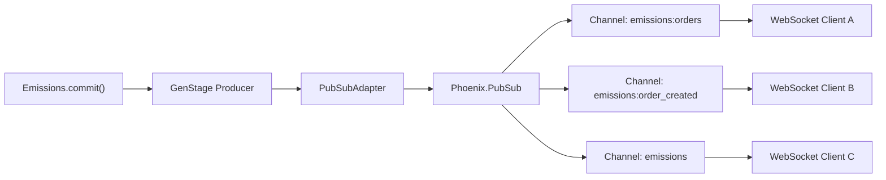

# Phoenix Channels

Emissions ships an optional Phoenix Channels adapter that broadcasts events over WebSockets. When enabled, events committed through the pipeline are pushed to connected clients in real time.

## Installation

Add `:phoenix` to your dependencies if not already present:

```elixir
{:phoenix, "~> 1.7"}
```

The Phoenix adapter modules are compiled only when Phoenix is available. If your project does not include `:phoenix`, the modules simply won't exist.

## Quick Start

Three steps to get events flowing to WebSocket clients:

### 1. Add the adapter to your config

```elixir
config :emissions,
  adapters: [
    {Emissions.Phoenix.PubSubAdapter, pubsub: MyApp.PubSub}
  ]
```

### 2. Create a channel

```elixir
defmodule MyAppWeb.EmissionsChannel do
  use Emissions.Phoenix.Channel
end
```

### 3. Mount the channel in your socket

```elixir
defmodule MyAppWeb.UserSocket do
  use Phoenix.Socket

  channel "emissions:*", MyAppWeb.EmissionsChannel

  @impl true
  def connect(_params, socket, _connect_info), do: {:ok, socket}

  @impl true
  def id(_socket), do: nil
end
```

That's it. Any events committed through the Emissions pipeline will be pushed to connected WebSocket clients.

## How It Works



The `PubSubAdapter` receives event batches from the GenStage pipeline, serializes each event, and broadcasts it to Phoenix.PubSub topics. The channel subscribes to PubSub on join and pushes incoming events to connected clients.

## Topic Hierarchy

Each event is broadcast to multiple PubSub topics, allowing clients to subscribe at different granularity levels:

| Level | Topic Example | Receives |
|---|---|---|
| Catch-all | `"emissions"` | Every event |
| Topic group | `"emissions:orders"` | Events mapped to the `orders` topic (requires TopicRouter) |
| Event name | `"emissions:order_created"` | Only `order_created` events |

A client joining `"emissions:orders"` receives all order-related events. A client joining `"emissions:order_created"` receives only that specific event type. A client joining `"emissions"` receives everything.

## TopicRouter Integration

When you configure a `TopicRouter`, events are also broadcast to their mapped topic group:

```elixir
defmodule MyApp.Topics do
  use Emissions.TopicRouter,
    mappings: %{
      orders: [:order_created, :order_updated, :order_shipped],
      users: [:user_created, :user_updated]
    }
end
```

```elixir
config :emissions,
  adapters: [
    {Emissions.Phoenix.PubSubAdapter,
     pubsub: MyApp.PubSub,
     topic_router: MyApp.Topics}
  ]
```

An `:order_created` event would then be broadcast to `"emissions:orders"`, `"emissions:order_created"`, and `"emissions"`.

Without a TopicRouter, events are only broadcast to the event-name and catch-all topics.

## Multi-Tenant Scoping

For multi-tenant applications, configure the `:scope` option to insert a tenant identifier into all topic strings. This ensures events are broadcast only to channels subscribed to that specific tenant.

### Configuration

Use an atom to extract the scope from event metadata:

```elixir
config :emissions,
  adapters: [
    {Emissions.Phoenix.PubSubAdapter,
     pubsub: MyApp.PubSub,
     scope: :org_id}
  ]
```

Or use a function for custom logic:

```elixir
config :emissions,
  adapters: [
    {Emissions.Phoenix.PubSubAdapter,
     pubsub: MyApp.PubSub,
     scope: fn event -> event.metadata[:org_id] end}
  ]
```

### Scoped Topic Structure

When scope resolves to a non-nil value (e.g., `"acme"`), all topics include the scope segment:

| Level | Topic Example | Receives |
|---|---|---|
| Scoped catch-all | `"emissions:acme"` | All events for tenant "acme" |
| Scoped topic group | `"emissions:acme:orders"` | Order events for tenant "acme" (with TopicRouter) |
| Scoped event name | `"emissions:acme:order_created"` | `order_created` events for tenant "acme" |

When scope resolves to `nil` (e.g., metadata key is missing), topics fall back to the unscoped format.

### Usage

Emit events with tenant metadata:

```elixir
Emissions.emit(:order_created, %{id: 123}, %{org_id: "acme"})
Emissions.commit()
```

Subscribe clients to tenant-specific channels:

```javascript
const channel = socket.channel("emissions:acme:orders", {});
channel.join();
channel.on("event", (payload) => {
  console.log("Acme order event:", payload);
});
```

### Channel Authorization

Combine scoping with channel authorization to enforce tenant boundaries:

```elixir
defmodule MyAppWeb.EmissionsChannel do
  use Emissions.Phoenix.Channel

  def join("emissions:" <> rest = topic, params, socket) do
    tenant_id = socket.assigns[:tenant_id]

    if rest == tenant_id or String.starts_with?(rest, tenant_id <> ":") do
      super(topic, params, socket)
    else
      {:error, %{reason: "unauthorized"}}
    end
  end
end
```

## Custom Serialization

The default serializer converts events into maps with `name`, `payload`, `metadata`, and `timestamp` keys. The PubSubAdapter accepts any module implementing `Emissions.Serializer` (or the narrower `Emissions.Phoenix.Serializer` which constrains the return type to `map()`).

For non-Phoenix serialization (binary formats, custom encodings), see the [Serialization guide](serialization.md).

Implement a custom serializer for a different wire format:

```elixir
defmodule MyApp.EmissionsSerializer do
  @behaviour Emissions.Phoenix.Serializer

  @impl true
  def serialize(event) do
    %{
      type: event.name,
      data: event.payload,
      occurred_at: event.timestamp
    }
  end
end
```

```elixir
config :emissions,
  adapters: [
    {Emissions.Phoenix.PubSubAdapter,
     pubsub: MyApp.PubSub,
     serializer: MyApp.EmissionsSerializer}
  ]
```

## Authorization

Override `join/3` in your channel to add authorization:

```elixir
defmodule MyAppWeb.EmissionsChannel do
  use Emissions.Phoenix.Channel

  def join(topic, params, socket) do
    if authorized?(socket, topic) do
      super(topic, params, socket)
    else
      {:error, %{reason: "unauthorized"}}
    end
  end

  defp authorized?(socket, _topic) do
    socket.assigns[:user_id] != nil
  end
end
```

The generated `join/3` is `defoverridable`, so `super/3` delegates to the default implementation which subscribes to the PubSub topic.

## Adapter Options

| Option | Default | Description |
|---|---|---|
| `:pubsub` | (required) | The `Phoenix.PubSub` server name |
| `:topic_prefix` | `"emissions"` | Prefix for all topic strings |
| `:topic_router` | `nil` | Module using `Emissions.TopicRouter` |
| `:scope` | `nil` | Atom (metadata key) or 1-arity function to resolve tenant scope |
| `:serializer` | `DefaultSerializer` | Module implementing `Emissions.Phoenix.Serializer` |

## JavaScript Client

Connect using the `phoenix` npm package:

```javascript
import { Socket } from "phoenix";

const socket = new Socket("/socket", { params: { token: userToken } });
socket.connect();

// Subscribe to all order events
const ordersChannel = socket.channel("emissions:orders", {});
ordersChannel.join();
ordersChannel.on("event", (payload) => {
  console.log("Order event:", payload.name, payload.payload);
});

// Or subscribe to a specific event type
const createdChannel = socket.channel("emissions:order_created", {});
createdChannel.join();
createdChannel.on("event", (payload) => {
  console.log("New order:", payload.payload);
});
```

## Testing

Test your channel using `Phoenix.ChannelTest`:

```elixir
defmodule MyAppWeb.EmissionsChannelTest do
  use ExUnit.Case
  import Phoenix.ChannelTest

  @endpoint MyAppWeb.Endpoint

  test "receives events pushed to the channel" do
    {:ok, _, _socket} =
      socket(MyAppWeb.UserSocket, nil, %{})
      |> subscribe_and_join(MyAppWeb.EmissionsChannel, "emissions:orders")

    Phoenix.PubSub.broadcast(
      MyApp.PubSub,
      "emissions:orders",
      {:emissions_event, %{name: :order_created, payload: %{id: 1}}}
    )

    assert_push "event", %{name: :order_created}
  end
end
```
