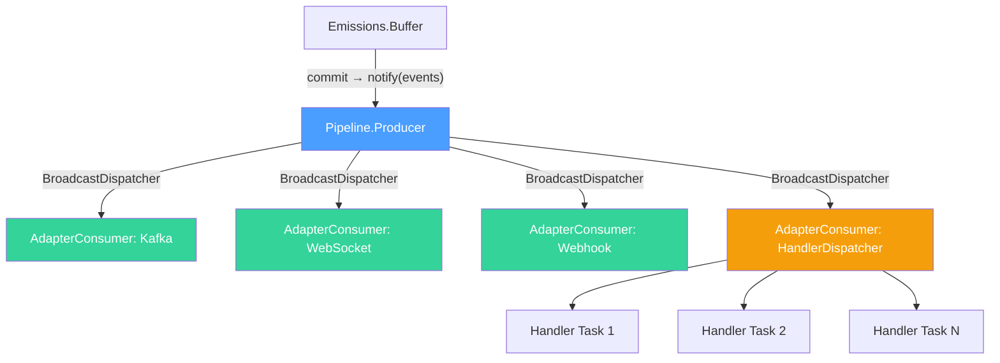
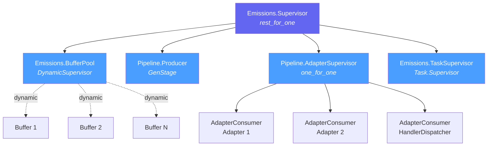

# GenStage Pipeline

Emissions uses a GenStage pipeline to fan out committed events to all configured adapters using shared broadcast demand.

## Architecture



## Producer

`Emissions.Pipeline.Producer` is a named GenStage producer that uses `GenStage.BroadcastDispatcher`. This dispatcher sends every event to every subscribed consumer, enabling true fan-out.

When a buffer commits, it calls `Producer.notify/1` which pushes events into the producer via `GenStage.cast`. The producer drains its internal queue in response to demand from consumers.

## Adapter Consumers

Each configured adapter is wrapped in an `Emissions.Pipeline.AdapterConsumer` — a GenStage consumer that subscribes to the producer. Each consumer:

1. Calls the adapter's `init/1` on startup
2. Subscribes to the producer with configurable `max_demand`
3. Optionally filters events via `interested?/2`
4. Delegates to `handle_events/2` for delivery
5. Reports success/failure via telemetry

## Backpressure

BroadcastDispatcher waits for demand from every subscribed consumer. A stalled adapter therefore delays delivery to healthy adapters once its outstanding demand is exhausted.

`commit/0` and `flush/0` acknowledge local, asynchronous handoff. The producer keeps up to `pipeline: [buffer_size: 10_000]` pending events by default. On overflow GenStage discards older buffered events, logs a warning and emits `[:emissions, :pipeline, :discarded]` with the discarded count. In-flight messages and request buffers are separate from this limit. Restarts and adapter failures can also lose events. For billing or other durable workflows, persist an outbox entry in the business transaction and retry delivery from that record.

## Supervision



The top-level supervisor uses `rest_for_one` strategy. If the producer crashes, all adapter consumers are restarted (since they subscribe to the producer). The `AdapterSupervisor` uses `one_for_one` so a single adapter crash doesn't affect others.

## Configuration

Tune the pipeline via the `:pipeline` config key:

```elixir
config :emissions,
  pipeline: [
    max_demand: 50   # events per consumer per batch (default: 50)
  ]
```

Higher `max_demand` means larger batches to adapters (better throughput, higher latency). Lower values mean smaller batches (lower latency, more overhead).

## Handler Dispatcher

The `Emissions.HandlerDispatcher` is a special adapter that dispatches events to internal handlers. It's automatically added to the pipeline when handlers are configured. It implements the same `Emissions.Adapter` behaviour, so it participates in the GenStage pipeline like any other adapter.
