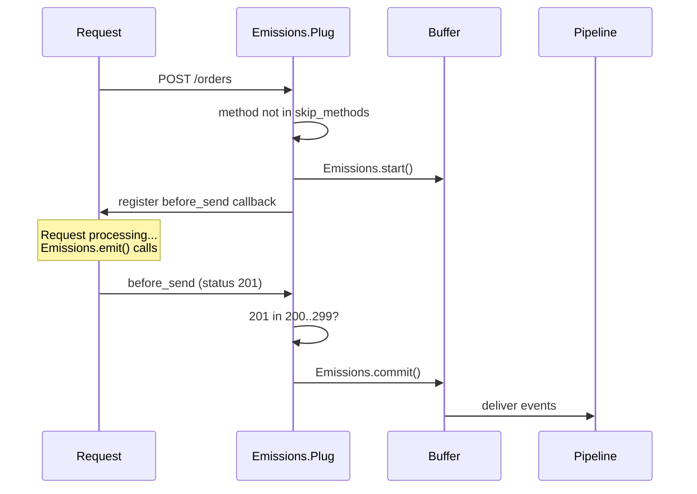
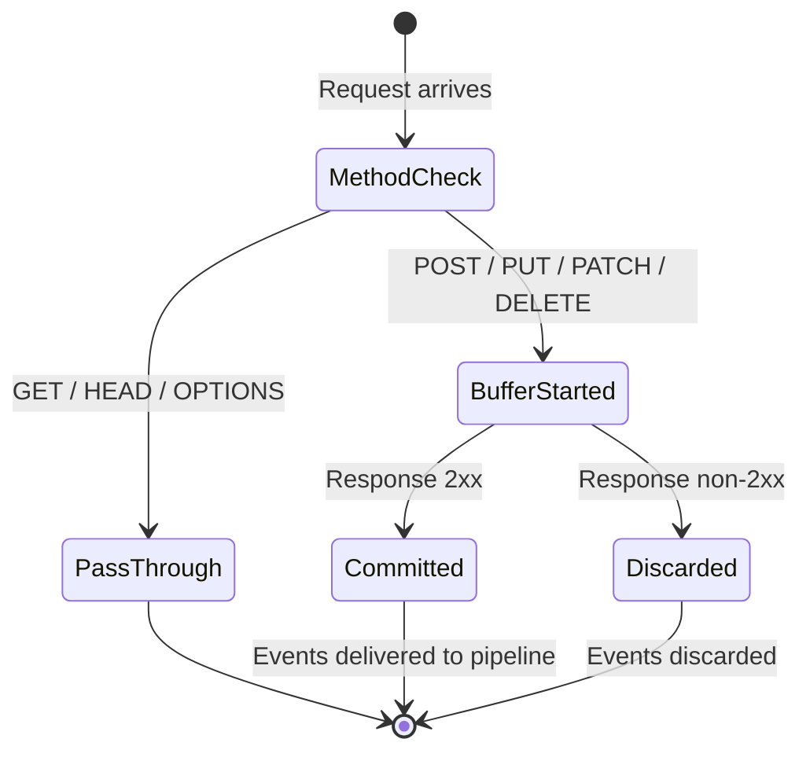

# Plug Integration

Emissions provides an optional Plug for automatic buffer lifecycle management in Phoenix and Plug-based applications. Instead of manually calling `start/0`, `commit/0`, and `terminate/0` around each request, the plug handles it for you.

## Installation

Add `:plug` to your dependencies if not already present:

```elixir
{:plug, "~> 1.14"}
```

The `Emissions.Plug` module is compiled only when Plug is available. If your project does not include `:plug`, the module simply won't exist.

## Usage

Add the plug to your Phoenix router or endpoint:

```elixir
defmodule MyAppWeb.Router do
  use MyAppWeb, :router

  pipeline :api do
    plug :accepts, ["json"]
    plug Emissions.Plug
  end

  scope "/api", MyAppWeb do
    pipe_through :api

    resources "/orders", OrderController
  end
end
```

Then emit events anywhere in your request handling code:

```elixir
defmodule MyAppWeb.OrderController do
  use MyAppWeb, :controller

  def create(conn, params) do
    case Orders.create(params) do
      {:ok, order} ->
        Emissions.emit(:order_created, %{id: order.id, total: order.total})
        json(conn, %{id: order.id})

      {:error, changeset} ->
        conn
        |> put_status(:unprocessable_entity)
        |> json(%{errors: format_errors(changeset)})
    end
  end
end
```

On a successful response the plug commits your events. On an error response it discards them automatically.

## How It Works



For read-only methods (`GET`, `HEAD`, `OPTIONS`) the plug is a no-op — no buffer is started and the request passes through untouched.

For mutating methods the plug:

1. Calls `Emissions.start/0` to open a per-request buffer.
2. Registers a Plug `before_send` callback.
3. When the response is sent:
   - **2xx status** → `Emissions.commit/0` delivers all buffered events to the pipeline.
   - **Any other status** → `Emissions.terminate/0` discards the buffer.

## Options

### `:skip_methods`

List of HTTP methods (uppercase strings) that bypass the plug entirely. No buffer is started for these requests.

**Default:** `["GET", "HEAD", "OPTIONS"]`

```elixir
# Only skip GET requests
plug Emissions.Plug, skip_methods: ["GET"]
```

### `:commit_statuses`

Range or list of HTTP status codes that trigger `Emissions.commit/0`. All other statuses trigger `Emissions.terminate/0`.

**Default:** `200..299`

```elixir
# Also commit on 3xx redirects
plug Emissions.Plug, commit_statuses: 200..399
```

```elixir
# Only commit on exactly 200 and 201
plug Emissions.Plug, commit_statuses: [200, 201]
```

## Request Lifecycle


