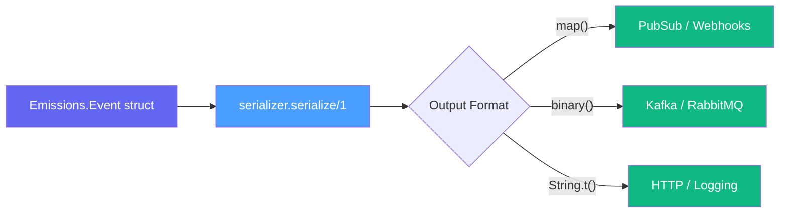

# Serialization

Serializers transform `Emissions.Event` structs into adapter-specific formats before delivery. Each adapter can accept a `:serializer` option to customize how events are encoded for its target system.

## Default Behaviour

When no serializer is configured, adapters should use `Emissions.Serializer.Default`, which converts events into JSON-friendly maps:

```elixir
%{
  name: :order_created,
  payload: %{id: 1, total: 99.99},
  metadata: %{source: "api"},
  timestamp: 1706000000000000
}
```

This requires zero configuration — adapters that follow the convention of defaulting to `Emissions.Serializer.Default` in their `init/1` work out of the box.

## Implementing a Custom Serializer

Implement the `Emissions.Serializer` behaviour with a single `serialize/1` callback:

```elixir
defmodule MyApp.CompactSerializer do
  @behaviour Emissions.Serializer

  @impl true
  def serialize(event) do
    %{
      type: event.name,
      data: event.payload,
      ts: event.timestamp
    }
  end
end
```

The return type is `term()`, giving serializers full flexibility over the output format.

### Map Serializers

Map serializers are the most common choice for adapters that broadcast to Phoenix PubSub, webhooks, or any JSON-based transport:

```elixir
defmodule MyApp.WebhookSerializer do
  @behaviour Emissions.Serializer

  @impl true
  def serialize(event) do
    %{
      event_type: to_string(event.name),
      data: event.payload,
      occurred_at: DateTime.from_unix!(event.timestamp, :microsecond)
    }
  end
end
```

### Binary Serializers

For adapters that need binary wire formats — Kafka with Avro, RabbitMQ with Protobuf, or any other binary protocol:

```elixir
defmodule MyApp.AvroSerializer do
  @behaviour Emissions.Serializer

  @impl true
  def serialize(event) do
    MyApp.Avro.encode(%{
      "name" => to_string(event.name),
      "payload" => event.payload,
      "metadata" => event.metadata,
      "timestamp" => event.timestamp
    })
  end
end
```

## How Adapters Use Serializers

Adapters accept a `:serializer` option in their configuration and fall back to the default:

```elixir
defmodule MyApp.KafkaAdapter do
  @behaviour Emissions.Adapter

  @impl true
  def init(opts) do
    serializer = Keyword.get(opts, :serializer, Emissions.Serializer.Default)
    {:ok, %{producer: Keyword.fetch!(opts, :producer), serializer: serializer}}
  end

  @impl true
  def handle_events(events, state) do
    for event <- events do
      payload = state.serializer.serialize(event)
      MyKafka.produce(state.producer, payload)
    end

    {:ok, state}
  end
end
```

Configure the serializer alongside other adapter options:

```elixir
config :emissions,
  adapters: [
    {MyApp.KafkaAdapter,
     producer: MyApp.KafkaProducer,
     serializer: MyApp.AvroSerializer}
  ]
```

## Serialization Flow



## Phoenix Channels

The Phoenix Channels adapter (`Emissions.Phoenix.PubSubAdapter`) supports serialization out of the box. It defaults to `Emissions.Phoenix.DefaultSerializer`, which delegates to `Emissions.Serializer.Default`.

For Phoenix-specific serializers that must return maps (required for PubSub broadcasting), use the `Emissions.Phoenix.Serializer` behaviour which narrows the return type to `map()`.

Any module implementing `Emissions.Serializer` that returns a map also works with the PubSubAdapter. See the [Phoenix Channels guide](phoenix-channels.md) for details.
